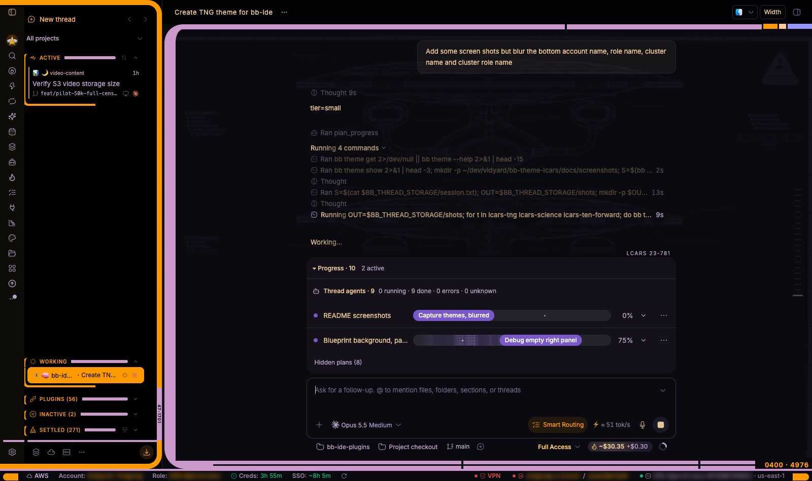
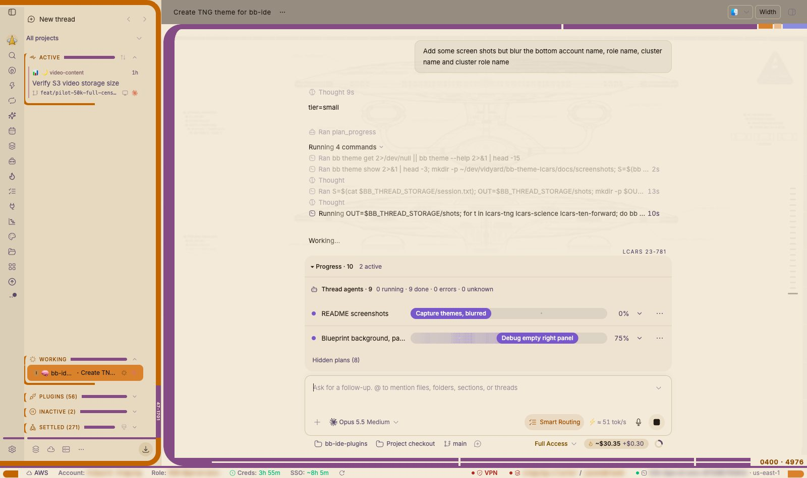
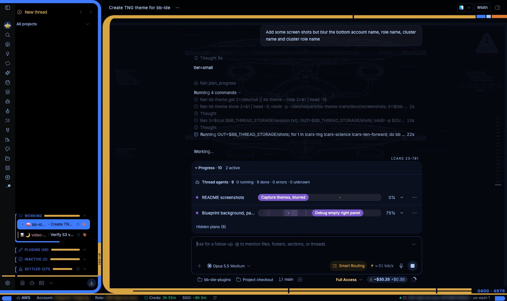
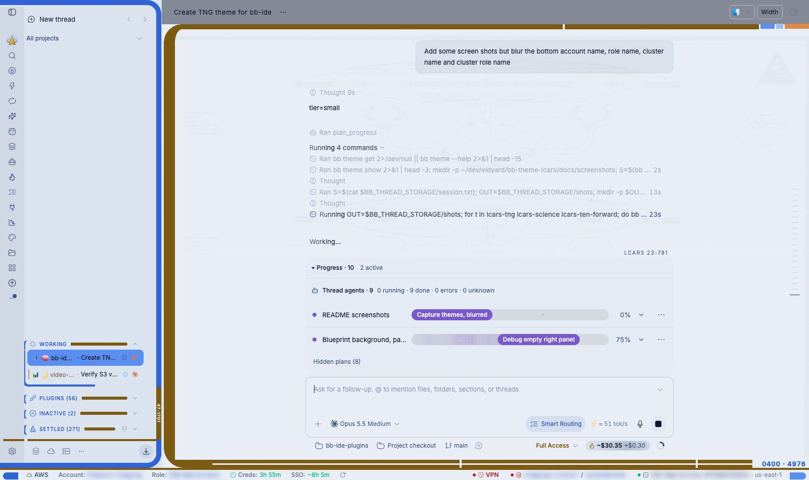
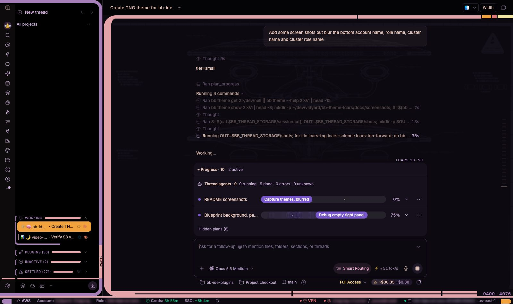
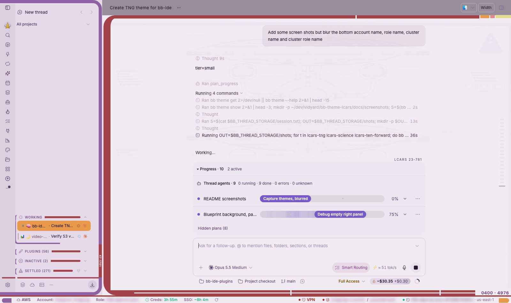

# Starship Console

Retro sci-fi console themes for the bb IDE. Inspired by 1980s–90s TV sci-fi interfaces. Fan-made; not affiliated with any studio.

| Theme | Id | Accent |
|---|---|---|
| Starship Console: Bridge | `console-bridge` | Orange and lavender (the classic bridge look) |
| Starship Console: Science | `console-science` | Blue (science and operations) |
| Starship Console: Lounge | `console-lounge` | Purple and mauve (a quiet lounge palette) |

The theme source folders keep their original names: `themes/lcars-tng` (Bridge), `themes/lcars-science` (Science) and `themes/lcars-ten-forward` (Lounge).

Each theme has a light mode and a dark mode.

## Screenshots

The account, role, cluster and profile names in the status bar are blurred.

| | Dark | Light |
|---|---|---|
| Bridge |  |  |
| Science |  |  |
| Lounge |  |  |

## What the themes change

- A console elbow frame around the left sidebar and the right panel.
- A thick frame around the thread window, with large elbows, a segmented top bar and a two-row bottom band with a readout.
- Thread rows that look like console menu buttons. The open thread is a solid rounded rectangle.
- Sidebar groups in console brackets. Collapsed group headers are complete bars.
- Flat pill caps on the bottom status bar, and a communicator badge for the Home icon.
- Pill buttons and badges.
- Decorative console number labels.
- A faded starship blueprint behind the thread area. It takes the colour of the theme.

All text colours pass WCAG AA contrast (4.5:1 or better).

## Install

Install as a bb plugin from a local checkout:

```sh
bb plugin install /path/to/bb-theme-lcars   # the checkout folder name can differ
```

The plugin adds three themes. Select one in Settings, Appearance, or with the CLI:

```sh
bb theme set plugin:starship-console:console-bridge
bb theme set plugin:starship-console:console-science
bb theme set plugin:starship-console:console-lounge
```

Check the package with `bb plugin build .`.

### Install as a custom theme

Without the plugin, copy a theme folder into your bb theme directory, then select it:

```sh
THEME_DIR="$HOME/.bb-machines/<your-bb-host>/theme"   # see `bb theme list` for the path
cp -R themes/lcars-tng themes/lcars-science themes/lcars-ten-forward "$THEME_DIR/"
bb theme set lcars-tng
```

bb reloads the theme when the file changes. Do not use both methods at the same time if you want one list of themes.

## Change the themes

- Edit the CSS in `themes/<name>/theme.css`. Keep the chrome rules the same in all three files. Only the token blocks and the baked SVG stroke colours differ.
- Tune the background strength with `--lcars-schematic-opacity` in each token block.
- Run `python3 tools/qa_lcars.py` after a change. It checks syntax, tokens, contrast and that the chrome rules match across the three themes.

### Replace the background image

1. Edit the single-colour drawing in `assets/schematic.svg`.
2. Embed it in all three themes: `python3 tools/apply_blueprint.py`

The tools use only the Python standard library.

## Notes

- The styles target bb's live DOM (tested on bb 0.50.1). A bb update can change the DOM hooks, and some chrome can then stop matching.
- LCARS and Star Trek are Paramount trademarks. Keep this repo private and for internal use. Do not publish it to a plugin marketplace.
